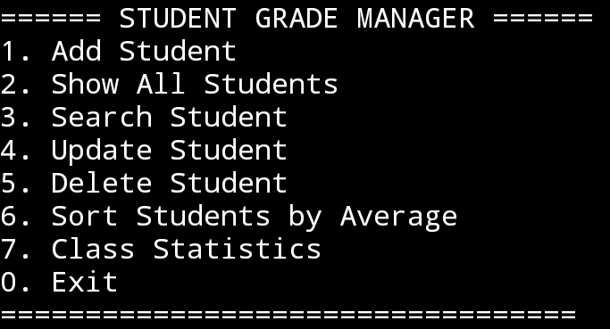

# Student Grade Manager

A C++17 console application for managing student records and grades.

## Features

- Add new students
- Display all student records
- Search for students by ID
- Update student grades
- Delete student records
- Sort students by average grade
- Display class statistics
- Calculate total marks and averages
- Determine pass/fail status
- Automatically save and load student records
- Validate input and handle invalid data files safely

## Technologies

- C++17
- Structs and Vectors
- Functions
- File Handling (fstream)
- Input Validation

## How to Compile and Run

```bash
g++ -std=c++17 -Wall -Wextra main.cpp -o student_manager
./student_manager

```

## Data Storage

Student records are stored in `students.txt` in the project directory.

The application loads saved records when it starts and saves changes automatically.

If the data file is invalid, the application preserves the original file.

## Screenshot



## Developer

Zeyad Mohamed Refaat
